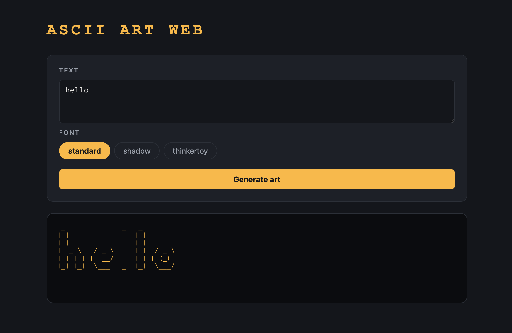

# ascii-art-web

A small web page that turns your text into ASCII art, for anyone who wants to try ascii-art without the terminal. This project focuses on making the site more appealing, responsive and interactive, and on giving the user clear feedback, using CSS.

## Authors
- Imad Elalouaji (ImadeddineElalouaji)
- Zineb Nadak (zinebnadak)

## To do
- [ ] Run `gofmt -l .` and `go vet ./...` before submitting I had problems with it 
- 

## How it works
ascii-art-web is a Go HTTP server that gives a web GUI to our previous project, ascii-art.
You type a text, pick a banner (`standard`, `shadow` or `thinkertoy`), press the button, and the server sends back the page with your text drawn in ASCII art.



## Responsive design (Zineb)
- [ ] Works on phone (375px), tablet (768px) and desktop (1440px) - open Cmd + Option + I
- [ ] No sideways page scroll, only the art box scrolls if the art is wide
- [ ] Less empty space around the page on phones
- [ ] Banner buttons wrap on small screens
- [ ] Input text is big enough to read on any screen 
- [ ] Textarea only resizes vertically, so it can't overflow the screen

## Interactive design (Imad)
- [ ]
- [ ]
- [ ]

## Usage: how to run and test
You need Go installed.

```bash
git clone https://github.com/zinebnadak/ascii-art-web.git
cd ascii-art-web
go run .
```

Then open [http://localhost:8080](http://localhost:8080) in Crome to be able to use devtools.


Code	How to trigger
404	Open http://localhost:8080/nope
405	Open http://localhost:8080/ascii-art
400	Type é in the textarea and click Generate
404   banner	mv banners/shadow.txt /tmp/, generate with shadow, then mv /tmp/shadow.txt banners/
500	chmod 000 banners/shadow.txt, generate with shadow, then unblock the file with chmod 644 banners/shadow.txt


| Method | Route        | What it does                                  |
|--------|--------------|-----------------------------------------------|
| GET    | `/`          | Shows the main page                           |
| POST   | `/ascii-art` | Receives `text` and `banner`, shows the art   |


Built at [grit:lab](https://gritlab.ax/) Åland (01-edu peer-learning program).
